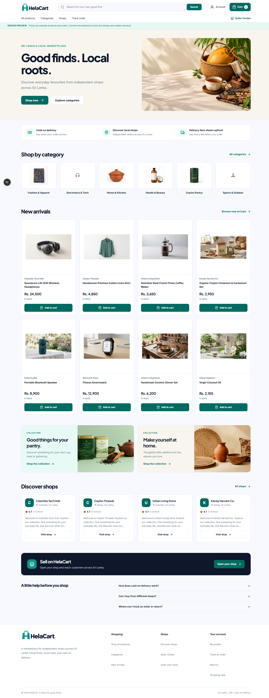
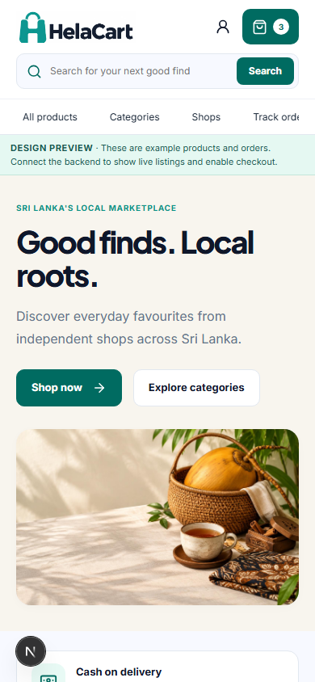

<div align="center">

# HelaCart

**Good finds. Local roots.**

A multi-vendor marketplace for independent shops across Sri Lanka, with a buyer storefront, Seller Center, and admin workspace.


[Features](#features) · [Screenshots](#screenshots) · [Getting started](#getting-started) · [Documentation](#documentation)

</div>

HelaCart brings product discovery, shop profiles, verified-purchase reviews, favorites, and cash-on-delivery ordering into one responsive web application. Sellers manage their shop and fulfillment, while administrators review applications, moderate listings, and manage storefront content.

## Features

### Buyer storefront

- Browse products and categories, search, filter by category and price, and sort results.
- Discover shops with logos, covers, public locations, ratings, and admin-awarded **Verified shop** badges.
- Save products to account-based favorites across devices, with current prices and availability.
- Choose product variants, manage a cart grouped by shop, and see delivery fees before checkout.
- Use saved addresses, place cash-on-delivery orders, and follow order status.
- Review destination-specific delivery fees at checkout and follow seller-provided courier references and delivery progress.
- Manage a personal profile, account security, notifications, cancellations, and return requests.
- Request returns for selected items/quantities, follow verified refund records, and open private support conversations.
- Review shops after a delivered purchase: 1–5 stars, comments, optional photos, edit/delete, and reporting.
- Review individual purchased products, browse rating summaries and seller replies, and manage previous feedback from the account.
- Read seller-supplied brands, specifications and warranty information, with an enlarged product-image gallery.
- Search across product/brand/shop details, use suggestions and recommendations, browse approved offers, and opt into favorite price/restock alerts.

### Seller Center

- Apply with mandatory front/back NIC or driving-licence photos and an optional business-registration image.
- Manage the shop profile, logo, cover, public location, private business details, and delivery fee.
- Configure district delivery rates, unavailable destinations, optional free-delivery thresholds, and dispatch estimates.
- Create and edit products, manage variants, upload images, and submit listings for approval.
- Adjust inventory and inspect stock movement history.
- Process COD orders through acceptance, packing, shipping, and delivery, with collection confirmation.
- Read buyer feedback and publish replies to shop reviews.
- Review commission charges, monthly statements, and balances; submit private bank-payment receipts for owner verification.
- Respond to support cases and submit records of actual buyer refunds for HelaCart verification.
- Reply to product reviews and manage shop managers through owner-only team permissions.
- Import counted stock from CSV with a preview, manage listings in bulk, configure stock alerts, and export date-filtered business reports.
- Submit scheduled product discounts for HelaCart approval and manage campaign cancellation/history.

### Admin workspace

- Review seller applications and identity documents; approve or reject applications.
- Award or revoke shop verification with recorded reasons and decision history.
- Moderate product submissions and manage category names, images, ordering, and archive/restore states.
- Edit homepage hero images and copy, preview changes, and publish content.
- Assign product-specific commission rates, configure payment days in Settings, hold disputed order commissions, verify seller bank payments, and record item-specific refund credits.
- Review item returns and buyer refund evidence, record corrections and resolution outcomes, and manage support conversations and case holds.
- Moderate reported reviews and manage the administrator's own profile and security.
- Moderate product-review reports and suspend or restore account access with recorded reasons and history.
- Review listings in bulk and inspect marketplace sales, shop performance, verified refunds, and commission reports.
- Approve, reject or cancel seller-funded promotions with recorded reasons and protected order-price snapshots.

Selling approval, shop identity verification, and verified-purchase reviews are separate workflows. Protected actions are checked by the API using Firebase identity and the relevant account, shop membership, or administrator permissions.

## Screenshots

These screenshots show the storefront's **labelled design-preview catalog**, using sample products and shops. They illustrate the responsive layout; they are not live marketplace activity.

<details>
<summary><strong>Desktop storefront — full page</strong></summary>



</details>

<details>
<summary><strong>Mobile storefront</strong></summary>



</details>

## Tech stack

| Layer | Technology |
| --- | --- |
| Web application | Next.js 16 App Router, React 19, TypeScript, Tailwind CSS 4, Lucide icons |
| REST API | NestJS 12, TypeScript, validated request DTOs |
| Database | PostgreSQL on Neon, Prisma 7, versioned migrations |
| Authentication | Firebase Authentication and Firebase Admin token verification |
| File storage | Cloudflare R2 with separate public and private buckets |
| API verification | Vitest, Supertest, lint, formatting, and TypeScript checks |

```text
Browser: storefront / Seller Center / admin
                    |
          Firebase Authentication
                    |
        NestJS REST API (/api/v1)
              /             \
    PostgreSQL + Prisma    Cloudflare R2
                           public images / private documents
```

## Repository structure

```text
HelaCart/
├── helacart-storefront/
│   ├── app/          # Next.js routes and layouts
│   ├── screens/      # Descriptively named buyer, seller, and admin screens
│   ├── components/   # Shared UI
│   ├── lib/          # API clients, authentication, state, and helpers
│   ├── public/       # Branding and storefront assets
│   └── docs/         # Feature notes and verification details
├── helacart-api/
│   ├── src/          # API modules and business logic
│   ├── prisma/       # Schema and database migrations
│   ├── test/         # HTTP tests and test helpers
│   └── scripts/      # Database and workflow verification utilities
└── docs/images/      # README screenshots
```

Next.js requires the `app/**/page.tsx` filenames. The screen implementations use descriptive filenames under `screens/`; see the [URL-to-screen index](helacart-storefront/screens/README.md).

## Getting started

### Prerequisites

- **Node.js 24.15 or newer within Node 24**, and **npm 11 or newer**, matching the API's declared engines.
- A PostgreSQL database. The supplied environment template is configured for Neon.
- A Firebase project with **Email/Password** authentication enabled, web-app settings, and an Admin SDK service account.
- Cloudflare R2 credentials and buckets for uploads and seller verification documents.

The commands below use **PowerShell**. On macOS/Linux, replace `Copy-Item` with `cp`.

```powershell
git clone https://github.com/Chamod-Theekshana/HelaCart.git
cd HelaCart
```

### 1. Configure and start the API

From the repository root:

```powershell
cd helacart-api
npm ci
Copy-Item .env.example .env
```

Fill in `.env` using the [API environment template](helacart-api/.env.example):

| Variable | Purpose |
| --- | --- |
| `DATABASE_URL` | Runtime database connection; use the pooled URL for Neon. |
| `DIRECT_URL` | Prisma migration connection; use the unpooled URL for the same database and branch. |
| `FIREBASE_PROJECT_ID` | Your Firebase project ID. |
| `GOOGLE_APPLICATION_CREDENTIALS` | Absolute path to your Firebase Admin service-account JSON, stored outside the repository. |
| `ADMIN_FIREBASE_UIDS` | Comma-separated Firebase UIDs allowed to administer the marketplace. Admin accounts must have verified emails. |
| `CORS_ORIGINS` | Allowed web origins; locally, `http://localhost:3000`. |
| `R2_ACCOUNT_ID`, `R2_ACCESS_KEY_ID`, `R2_SECRET_ACCESS_KEY` | R2 account and storage credentials. |
| `R2_BUCKET`, `R2_PUBLIC_BASE_URL` | Public image bucket and its public base URL. |
| `R2_PRIVATE_BUCKET` | Separate private bucket for identity documents and other access-controlled uploads. |

Keep the template's local host/port defaults unless needed. R2 can remain unconfigured for basic local browsing, but upload and document-submission flows need storage configured. Keep public access disabled on the private bucket. An empty admin allowlist leaves admin endpoints inaccessible.

After configuration, apply the checked-in migrations and start the API:

```powershell
npm run db:deploy
npm run start:dev
```

The API listens at `http://localhost:4000/api/v1`. Check `/health` for liveness and `/health/ready` for database readiness.

### 2. Configure and start the web application

Open a **second terminal at the repository root**:

```powershell
cd helacart-storefront
npm ci
Copy-Item .env.example .env.local
```

Set the browser settings in `.env.local`, using the **same Firebase project** as the API:

```dotenv
NEXT_PUBLIC_API_URL=http://localhost:4000/api/v1
NEXT_PUBLIC_FIREBASE_API_KEY=your-web-api-key
NEXT_PUBLIC_FIREBASE_AUTH_DOMAIN=your-project.firebaseapp.com
NEXT_PUBLIC_FIREBASE_PROJECT_ID=your-project-id
NEXT_PUBLIC_FIREBASE_APP_ID=your-web-app-id
```

```powershell
npm run dev
```

Open **http://localhost:3000**. Restart the web dev server after changing environment variables. Copy environment templates only during initial setup so existing settings are preserved. Firebase web settings belong in the browser; database credentials, R2 secrets, and Firebase Admin credentials belong only on the server.

### Design preview

Leave `NEXT_PUBLIC_API_URL` empty to explore the web application's explicitly labelled sample-data preview without configuring the API. Checkout and seller/admin writes are disabled in this mode; connected mode uses API data.

### Main routes

| Area | Routes |
| --- | --- |
| Shopping | `/`, `/products`, `/products/[id]`, `/shops`, `/shops/[slug]` |
| Buyer account | `/auth`, `/favorites`, `/cart`, `/checkout`, `/orders`, `/account` |
| Seller Center | `/seller`, `/seller/apply`, `/seller/products`, `/seller/inventory`, `/seller/orders`, `/seller/shop`, `/seller/reviews` |
| Administration | `/admin` and its protected management screens |

Register a buyer through `/auth`. Seller access requires an approved application and verified email. Admin access requires a verified Firebase account whose UID is in the API allowlist.

## Development and validation

Run API checks from `helacart-api/`:

```powershell
npm run check
```

This validates Prisma, formatting, lint, types, unit tests, HTTP tests, and the production build. Configure the API environment first. Real-database audit scripts are separate from these test suites; see the feature documentation before running them.

Run web checks from `helacart-storefront/`:

```powershell
npm run lint
npm run build
npx tsc --noEmit
```

Each app has its own `package.json` and lockfile. Install and run commands inside the corresponding app directory.

## Current scope

HelaCart currently supports **cash on delivery**. Sellers collect buyer payments and pay HelaCart commission separately by bank transfer, with owner verification. Each product remains commission-inactive until an admin assigns its rate. Order items freeze their rates and commission amounts at checkout; commission is due 14 days from successful delivery by default, with admin-configurable terms and return/dispute holds. Online payment gateways, automated refunds, seller payouts, and courier dispatch integrations are future extensions. Return resolution records the operational outcome; it does not automatically refund money or restock inventory.

Deployment configuration and real operational processes still need environment-specific verification before accepting public orders. See the [operations runbook](helacart-api/OPERATIONS-RUNBOOK.md) for deployment, backup, and COD operations guidance.

## Documentation

- [API setup and endpoint guide](helacart-api/README.md)
- [Web application notes](helacart-storefront/README.md) and [screen file index](helacart-storefront/screens/README.md)
- [Favorites and save-after-sign-in behavior](helacart-storefront/docs/product-favorites.md)
- [Seller commission, statements, and collection workflow](helacart-storefront/docs/seller-commission.md)
- [Delivery rates, tracking, and order notifications](helacart-storefront/docs/delivery-tracking.md)
- [Support cases, item returns, and refund records](helacart-storefront/docs/after-sales.md)
- [Product feedback, product details, and account permissions](helacart-storefront/docs/product-feedback-and-permissions.md)
- [Bulk tools, stock alerts, and business reports](helacart-storefront/docs/bulk-stock-and-business-reports.md)
- [Search, recommendations, favorite alerts, and promotions](helacart-storefront/docs/search-recommendations-and-promotions.md)
- [Shop profiles, reviews, photos, and moderation](helacart-storefront/docs/shops-and-reviews.md)
- [Verified shops and administrator decisions](helacart-storefront/docs/shop-verification.md)
- [Buyer, shop, and admin profiles](helacart-storefront/docs/account-profiles.md)
- [Categories and homepage content management](helacart-storefront/docs/storefront-content-management.md)
- [Order flow and inventory verification](helacart-storefront/docs/order-flow-audit.md)
- [Storefront visual refresh](helacart-storefront/docs/storefront-reference-refresh.md)

## License

The API package is marked `UNLICENSED`. This repository does not include an open-source license file.
